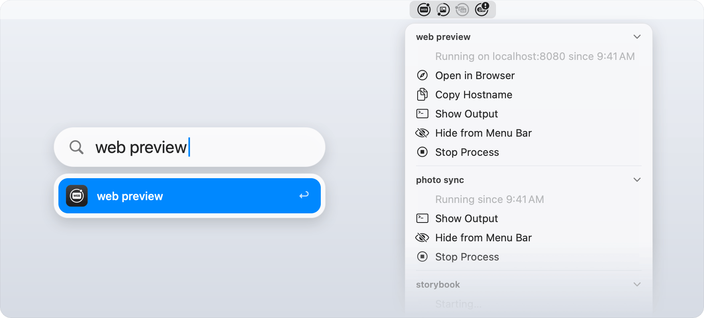
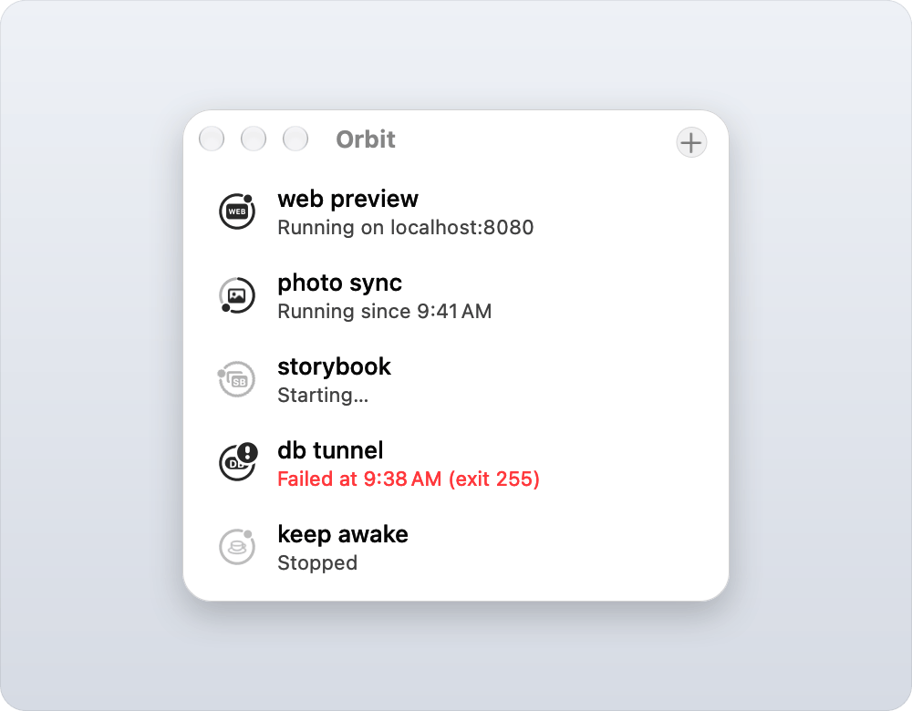

# Orbit

Start background tasks from Spotlight and see them in the menu bar. Native macOS, no dependencies.

<picture>
  <source media="(prefers-color-scheme: dark)" srcset="docs/hero-dark.png">
  
</picture>

An orbit is a command or script you run often: a local web server, an SSH tunnel, a sync. Type its name in
Spotlight to start it, again to stop it. The menu bar shows what is running, how far a task has got, and where a
service answers.

## Requirements

- macOS 15 or later
- The Xcode Command Line Tools (`xcode-select --install`)

## Install

```sh
git clone https://github.com/tbgihu/orbit && cd orbit && make install
```

This builds Orbit from source, signs it with your Apple Development certificate if you have one, else with a
certificate created for this Mac only, and installs it to `~/Applications/Orbit`, with the `orbit` command in
`~/.local/bin`. Keep the folder you cloned: Orbit updates from it.

`make uninstall` lists what it deletes, asks, then deletes all of Orbit's code and data: the app, the folder you
cloned, your orbits (`~/.config/orbit/orbits.json`), settings and logs. A certificate from Apple that Xcode uses
too stays.\
**Settings** has **Uninstall Orbit…**, which does the same, and **Export Configuration…** to save a copy of your
orbits first.

## Use

- Open **Orbit** and click **+** to add an orbit. Click one to start or stop it, drag to reorder, and right-click
  to edit or rename.
- Open Spotlight (`⌘ Space`, the Spotlight key, or the magnifying glass in the menu bar), type an orbit's name and
  press `↩` to start it. Do the same again to stop it.
- The menu bar shows a badge for each running orbit, with `!` on a failed one. Its menu lists every orbit, with
  the running and failed ones expanded, and opens Orbit.

<picture>
  <source media="(prefers-color-scheme: dark)" srcset="docs/window-dark.png">
  
</picture>

Each badge shows its orbit's state:

<picture>
  <source media="(prefers-color-scheme: dark)" srcset="docs/badges-dark.png">
  
</picture>

To share an orbit, send its entry from the configuration file. Orbit creates the Spotlight launcher by itself.

## Works with AI agents, Siri and Shortcuts

The `orbit` command does what the app does, for you, your scripts and AI agents.

| Command | What it does |
| --- | --- |
| `orbit list [<state>]` | every orbit and its state, or those in one state, like `running` or `failed` |
| `orbit status <orbit>` | one orbit in detail: state, progress, addresses, log |
| `orbit start <orbit>` | starts it and waits until it runs or answers at its address |
| `orbit stop <orbit>` | stops it and waits until it has ended |
| `orbit restart <orbit>` | stops it if it runs, then starts it |
| `orbit toggle <orbit>` | what its Spotlight launcher does |
| `orbit dismiss <orbit>` | clears the `!` of a failed run |
| `orbit stop-all` | stops every orbit |
| `orbit open <orbit> [<address>]` | opens where it answers: the browser, Screen Sharing or a terminal |
| `orbit output <orbit>` | shows its output in a terminal window that keeps following |
| `orbit logs <orbit> [-f] [-n <lines>]` | prints its latest output |
| `orbit add <name> --command <command>` | adds an orbit; the options are named like the keys of `orbits.json` |
| `orbit edit <orbit> --url <url>` | changes an orbit; what isn't given stays |
| `orbit rename <orbit> <new name>` | renames it; its launcher, log and history follow |
| `orbit delete <orbit>` | removes an orbit that isn't running; asks first unless `--yes` |
| `orbit check [<file>]` | validates `orbits.json` |
| `orbit window`, `orbit settings` | opens Orbit's window, or its settings |

`<orbit>` is an id or a name. With `--json` a command prints JSON instead of text (all but `help` and `logs -f`), and
the exit status tells a failed orbit (1) from an unknown one (3) and a broken `orbits.json` (4). `orbit help` lists
the rest.

Siri, Apple Intelligence and Shortcuts can do all of this too, and ask before they add, edit or delete an orbit. This
support needs Xcode and a free Apple Development certificate; **Settings** shows the steps. The everyday ones can
be said as they are: "Start web preview in Orbit", "What is running in Orbit". When Xcode left out Apple's
intermediate certificate that signed yours, Orbit adds it to your login keychain from `scripts/AppleWWDRCAG3.cer`
(from [apple.com/certificateauthority](https://www.apple.com/certificateauthority/)).

## Updates

Orbit updates itself from the clone you installed it from, in one of three modes, chosen in **Settings** (`⌘,`):
**Automatically**, **Download Only** or **Manually**. It never installs while an orbit is running.

`make update` in the clone updates at once. Like Orbit itself, it only runs when no orbit is running.

## Advanced

### Configuration file

Orbits are stored in `~/.config/orbit/orbits.json` (**File → Open Configuration File**), which you can also edit
by hand. See [the examples](orbits.example.json), and [the schema](orbits.schema.json) for every detail.

```json
{ "id": "web", "name": "web preview", "command": "python3 -m http.server 8080" }
```

| Key | Required | Description |
| --- | --- | --- |
| `id` | yes | 1 to 4 letters or digits, unique. Orbit knows an orbit by its id |
| `name` | yes | what you type in Spotlight. To rename an orbit, change this and keep the `id` |
| `command` or `script` | one of the two | what runs; a script file can be anywhere |
| `url` | no | the address this orbit answers at: `http(s)://`, `vnc://`, `ssh://` or `tcp://host:port`, several separated by commas. Left out, Orbit finds a service's addresses by itself, from the ports its processes listen on |
| `openInBrowser` | no | if this orbit serves a web page, it opens in your browser as soon as it answers. Default `true` |
| `cwd` | no | the folder it runs in. Default: a script's own folder, or your home folder for a command |
| `badge` | no | `"abc"`, `{ "symbol": "globe" }` or `{ "shape": "cards", "text": "L" }`. Default: the id as text |
| `kind` | no | `service` (runs until stopped) or `task` (ends by itself). Default: detected |
| `animate` | no | when the satellite turns: `auto`, `starting`, `always` or `off`. Default `auto` |

With `openInBrowser` on, every `http(s)` address in `url` opens. Of the addresses Orbit finds by itself, only those
that serve an HTML page open, so a dev server's other ports (live reload, an API) stay in the menu without a tab.

### What Orbit adds

The command runs as written, by zsh, with the same environment as your terminal (your shell's startup files, `.zshrc`
included), and these additions:

- `GIT_TERMINAL_PROMPT=0`, `SSH_ASKPASS_REQUIRE=never`, `PIP_NO_INPUT=1` and `PYTHONUNBUFFERED=1` in its environment,
  unless already set, so nothing waits for input that can't come and output reaches the log at once.
- `ssh` gets `BatchMode`, `ExitOnForwardFailure` and `ServerAliveInterval=15`, each only where your ssh config and the
  command leave it unset.
- For a task's progress ring, `git clone`, `fetch`, `pull` and `push` get `--progress`, and an `rsync` 3.1 or later gets
  `--info=progress2` unless the command sets its progress level, and with `progress2` also `--no-inc-recursive` unless
  the command sets incremental recursion, so it lists every file before copying and its totals are the whole run's.
  On a very large tree that list takes a moment and some memory.
- With **Open web page when ready** off, the command can't open web pages either, through `open` or `$BROWSER`.

## Privacy

Orbit collects nothing and sends nothing anywhere. Apart from checking whether your orbits answer at their own
addresses, its only network traffic is `git fetch` from the repository you cloned, for updates. Your orbits run
with your user's rights, as if you had started them in a terminal; their output is kept in `~/Library/Logs/Orbit`,
at most 10 MB per orbit.

## License

[Apache License 2.0](LICENSE)
